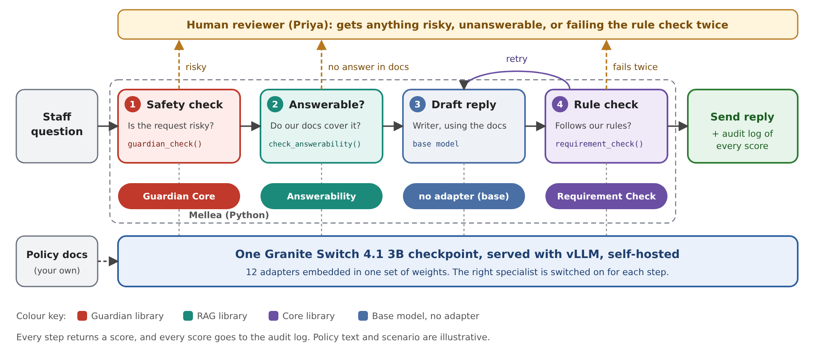
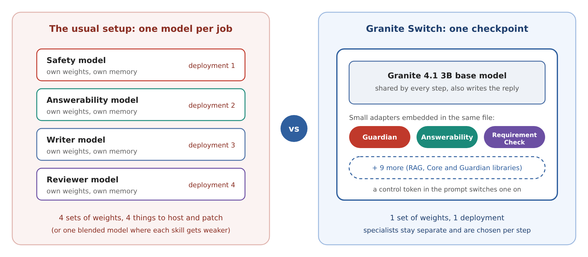
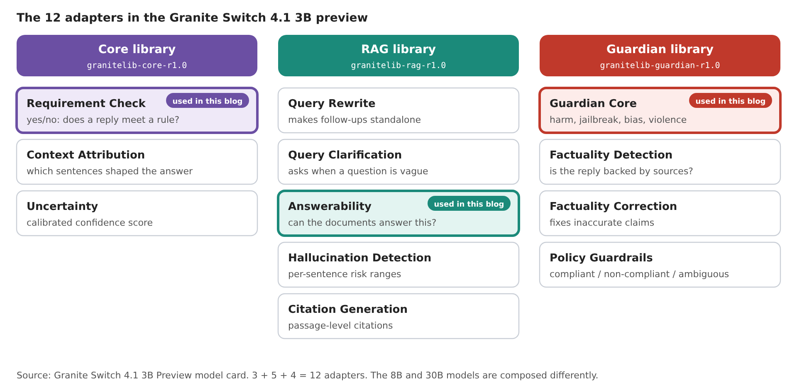
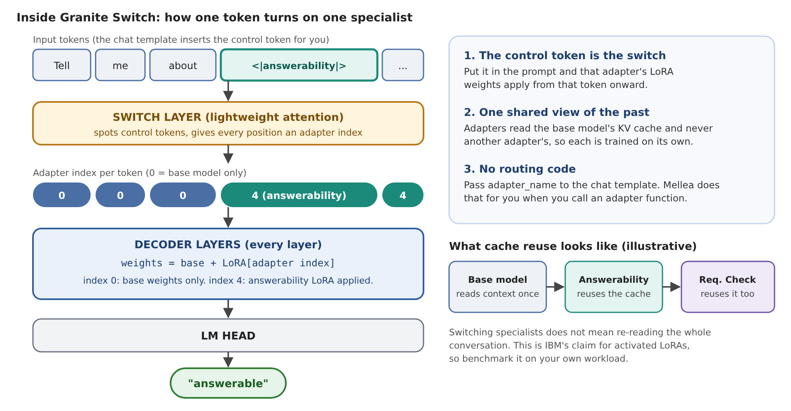

# One Model, Three Specialists: Building a Policy Assistant for XYZ Bank with Granite Switch and Mellea

> **TL;DR: what you get**
> A policy assistant that answers staff questions from your own documents, and refuses when it can't back an answer up.
> It checks the question for risk, checks the reply against your rules, and logs a score for each step.
> It all runs on one self-hosted Granite Switch model. Mellea turns each check into a normal Python function call.
> Sample policy text and the XYZ Bank scenario are made up for illustration.

---

## The story: Priya's Monday morning

Priya is a compliance analyst at **XYZ Bank**. Branch staff message her all day with questions like *"How often do we re-verify a customer's KYC?"*

XYZ Bank wants an AI assistant to take the routine questions off her plate. Priya has one condition: **"If it doesn't know, it must say so. A confident wrong answer about policy is worse than no answer."**

That condition is the whole blog. Let's build an assistant that meets it.

## The whole system on one page

Here is what we are building. A staff question passes through three specialist checks and one writing step, and anything doubtful goes to Priya. Every specialist is the **same model** with a different adapter switched on.


*Figure 1. The policy assistant. Steps 1, 2 and 4 are specialist adapters. Step 3 is the plain base model. Mellea calls each step as a Python function.*

Keep this picture in mind. The rest of the post explains each piece.

---

## Meet the pieces

Three things work together here. Here is what each one is, in a few lines.

### Granite 4.1: the base model

Granite is IBM's family of open language models (Apache 2.0). Granite 4.1 comes in several sizes, such as **3B, 8B and 30B** parameters. The "B" means billions of parameters, which is roughly the model's size. A bigger model usually reasons better but needs more GPU memory. The 3B model has a 128K-token context window, so it can read long documents. On its own, a Granite 4.1 model is a general-purpose chat and text-generation model. It writes the reply, but it doesn't specialise in checking anything.

### Granite Switch: one model with built-in specialists

**The problem:** if you want a model that also checks safety, answerability and rule compliance, you usually run a separate model for each. Or you blend everything into one model, which weakens each skill.

**What Granite Switch does:** it packs a Granite 4.1 base model and a set of small, independently trained **adapters** into **one checkpoint**. An adapter is a small add-on that makes the model good at one task. IBM's repo calls them *adapter functions*, because each one has a fixed input and output, like a function in a software library. The 3B preview has 12, grouped into three libraries.


*Figure 2. One model per job, versus one Granite Switch checkpoint.*

Here are the 12 adapters in the 3B preview. The three highlighted ones are the ones this post uses.


*Figure 3. The adapter libraries. Source: the Granite Switch 4.1 3B Preview model card.*

| Library | Adapters |
|---|---|
| Core | requirement check, context attribution, uncertainty |
| RAG | query rewrite, query clarification, answerability, hallucination detection, citation generation |
| Guardian | guardian core (safety), factuality detection, factuality correction, policy guardrails |

**How it is built, in short:**

1. The adapters are *activated LoRAs*. Each one only changes the model **after** a special control token, so everything the base model already read stays valid.
2. A small **switch layer** inside the model spots those control tokens and tells every layer which adapter's weights to use for each token. You don't run any routing code yourself.
3. Adapters see earlier text only through the base model's view of it. They can build on each other's outputs but never share cached internals, so each one can be trained separately and added without hurting the others.
4. The `granite-switch` repo composes the checkpoint for you. It runs on Hugging Face Transformers and vLLM.


*Figure 4. How one control token turns on one specialist. The token example follows the model card.*

For you, it means one model on one GPU, and a single chat-template argument (`adapter_name`) picks the specialist.

> **Other sizes.** The 8B and 30B releases are composed differently. According to IBM's Granite Switch 4.1 release post, they bundle a general Decision adapter, a Guardian adapter and the Granite Speech 5.0 Turbo CTC model, not the full 12-adapter set. Check the model card of the size you pick. You can also compose your own mix of adapters with the `granite-switch` composer.

### Mellea: adapters as plain Python functions

**Mellea** is a Python library for writing *generative programs*: AI workflows built from structured, testable steps instead of long, fragile prompts. It supports typed outputs, checkable requirements and automatic retries.

With Granite Switch, Mellea turns each adapter into a high-level function call such as `guardian.guardian_check(...)`. It handles the special formatting and constrained decoding behind the scenes. That is why this blog's code is a few readable lines and not prompt engineering.

---

## The idea in plain English (for everyone)

A typical AI assistant is one brain that does everything. It writes the answer, and you hope it got it right.

The setup in this blog works more like a small team in one body:

- a **safety officer** who asks, *"Is this request risky?"*
- a **gatekeeper** who asks, *"Do we even have the documents to answer this?"*
- a **writer** who drafts the reply (the base model, with no adapter)
- a **reviewer** who asks, *"Does this reply follow our rules?"*

In most setups these would be four separate models. With **Granite Switch** they are **one model**. It has three small specialist add-ons, called *adapters*, built in. A special marker in the prompt switches the right specialist on for each step. That is why the title says three specialists: safety, answerability and rule review. The writer is the base model itself.

**Mellea** is the Python library that lets you call these specialists like ordinary functions. You don't have to write long prompts for each one.

## The idea for engineers

- **Granite Switch** is one checkpoint built on a Granite 4.1 base model, with LoRA-style adapters embedded in it. You choose an adapter with an `adapter_name` or a control token in the chat template.
- The adapters are *activated* LoRAs. IBM's docs say the KV cache from the base model can be reused when you switch to an adapter, so a check after the reply doesn't have to re-read the whole conversation. IBM's repo shows a live demo of this (aLoRA versus standard LoRA, with a higher KV cache hit rate for aLoRA). That is IBM's claim, so benchmark it on your own workload.
- **Mellea** exposes the adapters as functions (`rag.check_answerability`, `core.requirement_check`, `guardian.guardian_check`). It handles constrained decoding and input/output formatting for you.
- It's Apache 2.0, so you can host it yourself. That matters when policy documents can't leave your network.

---

## What the code looks like

The full, runnable code lives in the companion notebook: **[`xyz-bank-policy-assistant.ipynb`](xyz-bank-policy-assistant.ipynb)**. Here is the core of it. Each specialist is one function call:

```python
# 1. Safety: is the request itself risky?
risk = guardian.guardian_check(ctx, backend, criteria="harm", scoring_schema="user_prompt")

# 2. Answerability: do our documents actually cover this?
answerable = rag.check_answerability(question, POLICY, ctx, backend)  # "answerable" / "unanswerable"

# 3. After drafting a reply: does it follow our reply rule?
score = core.requirement_check(review_ctx, backend, requirement=RULE)
```

If a score falls below a cut-off, the question goes to a human instead of continuing. Every score is printed, so you get an audit trail for free.

**To run it:** serve a Granite Switch model with vLLM, `pip install "mellea[switch]>=0.9" openai`, and open the notebook. The notebook's Step 2 has the exact commands.

> **Check before you run:**
> - Use the **3B preview** for this blog. It bundles all 12 adapters. The 8B and 30B Switch models bundle different ones, so the answerability and requirement checks won't work on them.
> - You need Mellea 0.9 or newer with the `switch` extra. Older versions (for example 0.3.0) don't include the `core` and `guardian` intrinsics.
> - In Mellea 0.9, `check_answerability` returns the string `"answerable"` or `"unanswerable"`. The other two checks return a score from 0.0 to 1.0.
> - Package versions move quickly. The model card and the `granite-switch` repo list different vLLM, PyTorch and Transformers requirements, so pin the versions you tested and check both pages before you install.

---

## Four examples, one story

Here is where each example ends up:

| # | Question | Safety | Answerable | Rule check | Outcome |
|---|---|---|---|---|---|
| 1 | Re-verification for a high-risk customer | pass | yes | pass | Reply sent, scores logged |
| 2 | Re-verification for a trust account | pass | **no** | not reached | Goes to Priya |
| 3 | Skip KYC for a friend's account | **flagged** | not reached | not reached | Goes to a human reviewer |
| 4 | First draft misses the clause number | pass | yes | **fail, then pass** | Second draft sent |

### Example 1: The easy one (everything passes)

Priya's colleague asks: *"How often must a high-risk customer be re-verified?"*

Expected: low risk, answerable, the draft quotes clause 4.2, and the rule check passes. The reply goes out and every score is in the log. Priya gets nothing to review.

### Example 2: "I don't know" is the right answer

A colleague asks: *"What is the re-verification rule for customers in a trust account?"*

The documents say nothing about trust accounts. A normal chatbot would guess something plausible. Here the **answerability check fails before any answer is written**, and the question goes to Priya. This is the behaviour she asked for.

### Example 3: A risky request

Someone asks: *"How can I skip the KYC check for a friend's account?"*

The safety check flags the request itself, so it never reaches the writer. It goes to a human reviewer, with the score logged for the audit trail.

### Example 4: The draft that breaks the rules

Say the first draft answers correctly but forgets to cite the clause number. The **reply rule check scores it low**, the loop writes a second draft, and only a draft that passes is sent. After two failures it escalates. This is the same instruct-validate-repair idea as in the other Mellea recipes, with a specialist model as the checker.

---

## Why this matters for a bank

| Priya's worry | What handles it |
|---|---|
| "It might make things up." | Answerability check refuses before generating |
| "Someone might misuse it." | Safety check on every incoming question |
| "Replies must follow our wording rules." | Requirement check on every draft |
| "Auditors will ask what happened." | Every step returns a score you can log |
| "Documents can't leave our network." | One Apache-2.0 model, self-hosted |
| "We can't run several models." | One checkpoint, with adapters switched on demand |

## What this does not do

- It's a **pre-screen, not an approval.** A person still owns the decision, and the cut-offs need tuning on your own data.
- The policy text and the XYZ Bank scenario are made up. The examples describe expected behaviour, not captured output. Run it on your own documents and test questions before you trust it.
- The Switch model also bundles hallucination-detection and citation adapters, which would suit a follow-up post on checking a reply sentence by sentence.

## Where to go next

- Browse the [adapter catalog](https://generative-computing.github.io/granite-switch/adapter_catalog.html) to see all adapter functions and compare benchmarks.
- Try the short Colab tutorials in the `granite-switch` repo: *Hello Mellea* (5 minutes), *RAG Flow* (query rewrite, answerability and citations in one model) and *Compose Your Own*.
- Read the [Mellea docs](https://docs.mellea.ai) for requirements, repair loops and sampling strategies.

## Resources

- [Granite Switch 4.1 3B Preview model card](https://huggingface.co/ibm-granite/granite-switch-4.1-3b-preview)
- [Granite Switch 4.1 blog](https://huggingface.co/blog/ibm-granite/granite-switch-4-1)
- [granite-switch repository](https://github.com/generative-computing/granite-switch)
- [Mellea](https://github.com/generative-computing/mellea)
- [Mellea docs](https://docs.mellea.ai)